# NVIDIA Cosmos 실험 실행방법

Spark는 가상 로봇을 실행하고, Thor는 Cosmos 추론을 담당한다. 장비가 없으면 Brev GPU 서버 한 대에서 두 역할을 실행한다. 아래 명령은 **Ubuntu의 Bash 터미널** 기준이다.

## 목차

1. [실험 범위와 준비물](#requirements)
2. [공통 준비: 코드 받기](#common)
3. [로컬: Spark와 Thor 설치·연결](#local)
4. [Brev: 서버 생성·설치·접속](#brev)
5. [Hugging Face: 모델 받기](#models)
6. [행동 실험: 바나나·큐브·망치](#policy)
7. [예측 영상과 실제 움직임 비교](#prediction)
8. [종료 영상 분석과 조명 변화 영상 생성](#media)
9. [반복 평가·결과 확인·종료](#results)
10. [문제 해결](#troubleshooting)

<a id="requirements"></a>
## 1. 실험 범위와 준비물

**DGX Spark와 Jetson Thor가 없어도 실습할 수 있다.** 장비가 준비되지 않았다면 [4장: Brev 환경](#brev)에서 GPU 서버 한 대를 빌려 두 장비의 역할을 함께 실행한다. 이 경우 3장의 로컬 장비 설치·연결은 건너뛴다.

| 항목 | 로컬 장비 | Brev |
|---|---|---|
| 시뮬레이션 | DGX Spark | RTX GPU가 있는 Ubuntu VM |
| 추론 | Jetson Thor | 같은 VM의 별도 Python 환경 |
| 화면 | Spark의 실제 GUI와 창 녹화 | 카메라 영상 저장, 브라우저 GUI·창 녹화 |
| 연결 | SSH + WebSocket | `127.0.0.1` WebSocket + 로컬 파일 복사 |

실험은 다음 순서로 진행한다. 학습은 수행하지 않는다.

| 순서 | 실험 | 조건 |
|---|---|---|
| 1 | 바나나·큐브 옮기기 | 자연 종료까지 각 1회 |
| 2 | 망치 난도 낮추기 | 빨간 망치만, 드릴도 제거한 조건 각각 60초 |
| 3 | 공식 실행 경로 비교 | 바나나 기준, 망치 기준·guidance interval 해제·horizon 16 |
| 4 | 미래 영상 비교 | 바나나·큐브 각각 32개 행동에 대한 예측과 실제 |
| 5 | 종료 결과 분석 | 마지막 영상·정지화면, 종료 후 3초 관찰 영상·정지화면 |
| 6 | 바나나 반복 평가 | 기본·±5cm·±10cm에서 각각 10회 |
| 선택 | 조명 변화 영상 생성 | 같은 시작 이미지에서 조명만 바꾸도록 요청 |

작업 성공·실패와 실행 오류를 구분해 기록한다. 예시와 결과가 다를 수 있으므로 자신의 영상과 결과 파일을 확인한다.

필요한 계정은 GitHub 저장소 접근 권한, Hugging Face 계정, 클라우드 실습 시 Brev 계정과 결제 수단이다. 저장소가 비공개이면 먼저 읽기 권한을 받아야 한다.

이 실습은 **Isaac Sim 5.1.0, Isaac Lab 2.3.2.post1**을 사용한다. 다른 버전의 설치 명령을 섞지 않는다. 시뮬레이터와 Cosmos는 Python·PyTorch 버전이 달라 **서로 다른 가상환경**을 사용한다.

| 환경 | Python | PyTorch / CUDA wheel |
|---|---|---|
| Spark ARM 시뮬레이터 | 3.11 | 2.9 / CUDA 13.0 |
| Brev x86 시뮬레이터 | 3.11 | 2.7 / CUDA 12.8 |
| 추론 환경 | 3.13 | 2.10 / CUDA 13.0 |

Brev의 x86 L40S 구성은 **NVIDIA 드라이버 580.65.06**을 사용한다. CUDA 13 지원 여부와 Isaac Sim 5.1의 렌더링 호환성을 함께 확인해야 한다. Spark·Thor에는 각 장비용 드라이버를 사용한다. `nvidia-smi`의 CUDA 표시는 드라이버가 지원하는 상한이며, 설치된 Python 패키지의 CUDA 버전과 다를 수 있다.

L40S 48GB 한 대에서 모든 실험을 순서대로 실행한다. 분석·생성 전에 정책 서버와 시뮬레이터를 종료해 GPU 메모리를 확보한다.

<a id="common"></a>
## 2. 공통 준비: 코드 받기

로컬 구성은 **Spark와 Thor 각각**, Brev 구성은 **VM 안에서 한 번** 실행한다. PC의 터미널과 VM 터미널을 구분한다.

```bash
sudo apt-get update
sudo apt-get install -y git git-lfs curl ffmpeg python3-venv \
  libgl1 libglu1-mesa libglib2.0-0 libgomp1 libx11-dev libvulkan1 vulkan-tools \
  libxrender1 libxi6 libxrandr2 libxinerama1 libxcursor1 libxtst6 \
  openssh-client rsync tmux x11-utils iputils-ping
git lfs install

curl -LsSf https://astral.sh/uv/0.12.23/install.sh | sh
export PATH="$HOME/.local/bin:$PATH"

git clone https://github.com/engiengi/physical-ai-system-design.git \
  "$HOME/physical-ai-system-design"
cd "$HOME/physical-ai-system-design/Cosmos"
export PROJECT_ROOT="$PWD"
export UV_CACHE_DIR="$PROJECT_ROOT/.cache/uv"
export HF_HOME="$PROJECT_ROOT/.cache/huggingface"
```

이미 저장소가 있으면 다시 복제하지 않고 해당 저장소의 `Cosmos` 폴더로 이동한다. 이 문서에서 `PROJECT_ROOT`는 **본인이 복제한 Cosmos 폴더**다. 새 터미널에서는 다음 명령을 다시 실행한다.

```bash
cd "$HOME/physical-ai-system-design/Cosmos"
export PROJECT_ROOT="$PWD"
export UV_CACHE_DIR="$PROJECT_ROOT/.cache/uv"
export HF_HOME="$PROJECT_ROOT/.cache/huggingface"
```

다른 위치에 복제했다면 위 `cd`만 자신의 위치로 바꾼다. 실행 중 생성한 데이터는 다음 위치에 저장된다.

```text
Cosmos/
├── spark/.venv/                 시뮬레이터 환경
├── spark/runs/                  행동·카메라 영상·에피소드 결과
├── spark/reports/               비교·평가 보고서
├── spark/captures/              GUI 화면 녹화
├── thor/.venv/                  추론 환경 (새 설치 기준)
├── thor/models/                 다운로드한 모델
└── thor/outputs/thor_project/    추론 요청·응답·생성 결과
```

환경·모델·영상·결과는 Git에 포함되지 않는다. 새로 복제한 저장소에는 과거 실험 영상이 없으며, 아래 실험을 실행해 직접 만든다.

<a id="local"></a>
## 3. 로컬: Spark와 Thor 설치·연결

### 3-1. Spark에 Isaac Sim·Isaac Lab 설치

**Spark 터미널**에서 실행한다. 이미 이 저장소의 `spark/.venv`가 설치되어 있으면 설치 명령을 건너뛰고 버전만 확인한다.

```bash
./spark/scripts/setup.sh
./spark/scripts/spark-python -c \
  'import importlib.metadata as m; print({n:m.version(n) for n in ("isaacsim","isaaclab","torch","robolab")})'
```

`setup.sh`가 고정 버전의 RoboLab과 Git LFS 자산을 받고, Python 3.11 환경에 패키지를 설치한다. 별도로 최신 Isaac Sim을 설치할 필요는 없다. 처음 실행할 때 NVIDIA 라이선스에 동의한 환경에서 진행한다.

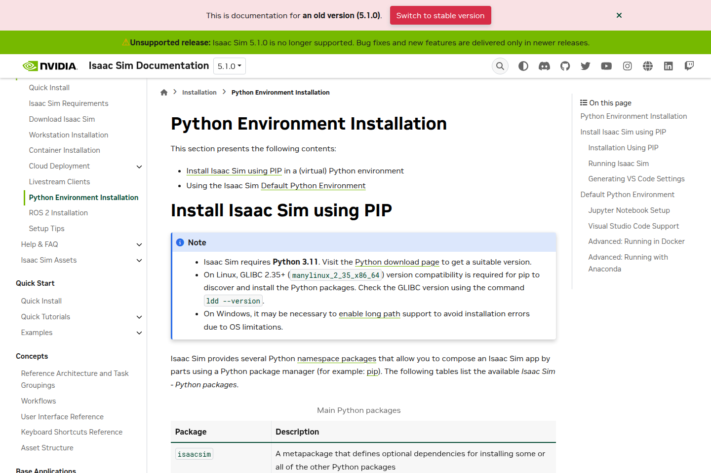

공식 설치 화면 참고. 이 문서는 이미지 속 명령을 옮겨 적는 대신 위 설치 스크립트를 사용한다. [Isaac Sim Python 설치 안내](https://docs.isaacsim.omniverse.nvidia.com/5.1.0/installation/install_python.html)

### 3-2. Thor 추론 환경 설치

**Thor 터미널**에서 [공통 준비](#common)를 완료한 뒤 실행한다.

```bash
nvidia-smi
./ops/setup-inference.sh
```

스크립트는 `thor/external/cosmos-framework`의 커밋을 고정하고 `thor/.venv`를 만든다. 기존 `.venv`가 있으면 덮어쓰지 않고 중단한다. 이미 실험용 환경이 있는 Thor에서는 재설치하지 말고 그 작업 공간을 다음 연결 설정에 사용한다.

이어서 Thor에서 [모델 받기](#models)를 완료한다. 모델을 받기 전에는 정책 서버를 시작하지 않는다.

### 3-3. Spark에서 Thor에 SSH 연결

두 장비를 같은 공유기에 연결한다. Wi-Fi도 가능하다. **Thor에서** 계정과 IP를 확인한다.

```bash
whoami
hostname -I
sudo systemctl enable --now ssh
```

`ssh` 서비스가 없으면 `sudo apt-get install -y openssh-server`로 설치한다.

**Spark에서** 다음을 실행한다. 입력값은 자신의 Thor 계정과 IP다.

```bash
read -rp 'Thor 접속 주소 (계정@IP): ' THOR_TARGET
test -f "$HOME/.ssh/id_ed25519" || ssh-keygen -t ed25519
ssh-copy-id "$THOR_TARGET"
ssh -o BatchMode=yes "$THOR_TARGET" 'echo SSH_OK'
```

`SSH_OK`가 표시되어야 한다. 개인키에 암호를 설정했다면 SSH 에이전트에 키를 등록한 후 다시 확인한다.

### 3-4. 장비별 경로 설정

**Spark에서** 실행한다. Thor를 이 문서대로 새 설치했다면 자동으로 올바른 경로를 얻는다.

```bash
THOR_ROOT=$(ssh "$THOR_TARGET" 'printf "%s" "$HOME/physical-ai-system-design/Cosmos/thor"')
read -rp "Thor 기존 작업 공간이 다르면 입력, 같으면 Enter [$THOR_ROOT]: " CUSTOM_THOR_ROOT
THOR_ROOT=${CUSTOM_THOR_ROOT:-$THOR_ROOT}
python3 - "$THOR_TARGET" "$THOR_ROOT" "$PROJECT_ROOT" <<'PY'
import json, sys
from pathlib import Path
host, remote, project = sys.argv[1:]
text = ('[thor]\nhost = '+json.dumps(host)+'\nworkspace = '+json.dumps(remote)
        +'\nuri = "ws://127.0.0.1:8000"\nport = 8000\n\n[spark]\nworkspace = '
        +json.dumps(str(Path(project)/'spark'))+'\n')
Path(project, 'config.local.toml').write_text(text)
PY
./lab deploy
./lab check
./lab start --seed 0
./lab logs --lines 40
```

`deploy`는 코드만 Thor에 복사한다. 가상환경과 모델은 앞 단계에서 Thor에 설치되어 있어야 한다. 이미 정책 서버가 실행 중이면 중복으로 시작하지 않는다.

Spark의 **별도 터미널**에서 터널을 연다. 이 터미널은 실험이 끝날 때까지 유지한다.

```bash
read -rp 'Thor 접속 주소 (계정@IP): ' THOR_TARGET
ssh -N -o ExitOnForwardFailure=yes -L 8000:127.0.0.1:8000 "$THOR_TARGET"
```

원래 **Spark 실험 터미널**에서 연결을 확인한다.

```bash
source ops/tutorial-env.sh local
./spark/scripts/spark-python -m cosmos_spark.network \
  --uri ws://127.0.0.1:8000 --handshake
```

첫 시뮬레이터 실행은 셰이더·렌더링 캐시 준비로 수 분 걸릴 수 있다. 모델 로딩이 끝나고 메타데이터가 수신되면 [행동 실험](#policy)으로 이동한다.

<a id="brev"></a>
## 4. Brev: 서버 생성·설치·접속

### 4-1. GPU VM 생성

1. [Brev 콘솔](https://brev.nvidia.com/)에 로그인한다.
2. **Create New Instance**를 선택한다.
3. 소프트웨어는 **VM Mode with Jupyter**를 선택한다.
4. 이 절차에서는 **AWS `g6e.2xlarge` / L40S 48GB 1개 / RAM 64GB / Ubuntu 22.04**를 선택한다.
5. 디스크는 **500GB 이상**으로 시작한다. 모델·패키지 캐시·녹화가 함께 저장된다.
6. 요금과 지역을 확인하고 이름을 입력한 뒤 **Deploy**를 누른다.

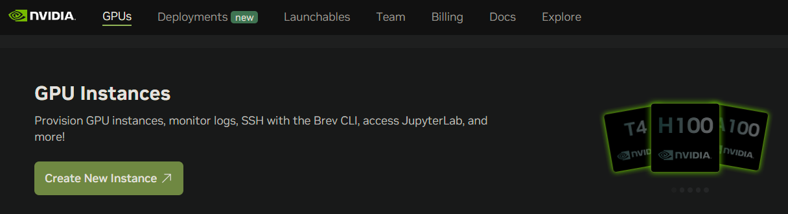

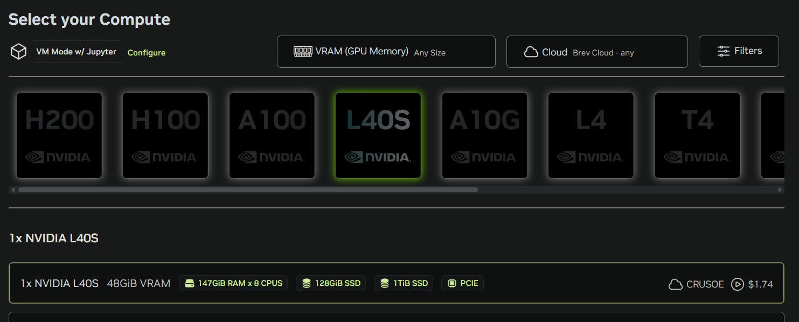

공식 Isaac Sim Brev 예시는 **L40S 48GB**다. 여기서는 시뮬레이터와 정책도 함께 실행하므로 첫 실험 후 메모리를 확인한다. **A100·H100은 Isaac Sim 5.1의 지원 GPU가 아니다.** [요구 사양](https://docs.isaacsim.omniverse.nvidia.com/5.1.0/installation/requirements.html)

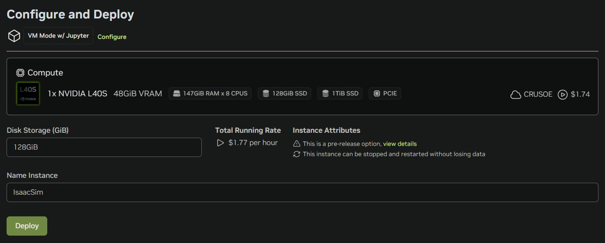

위 세 이미지는 NVIDIA 공식 문서의 UI 예시다. 화면의 가격·GPU 재고·기본 디스크 값은 현재 선택 화면에서 다시 확인한다. [공식 Brev 배포 안내](https://docs.isaacsim.omniverse.nvidia.com/5.1.0/installation/install_advanced_cloud_setup_brev.html)

### 4-2. VM 터미널 열기

인스턴스가 준비되면 **Open Notebook → Terminal**을 연다.

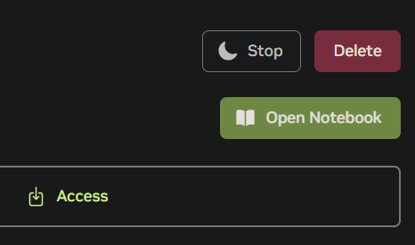

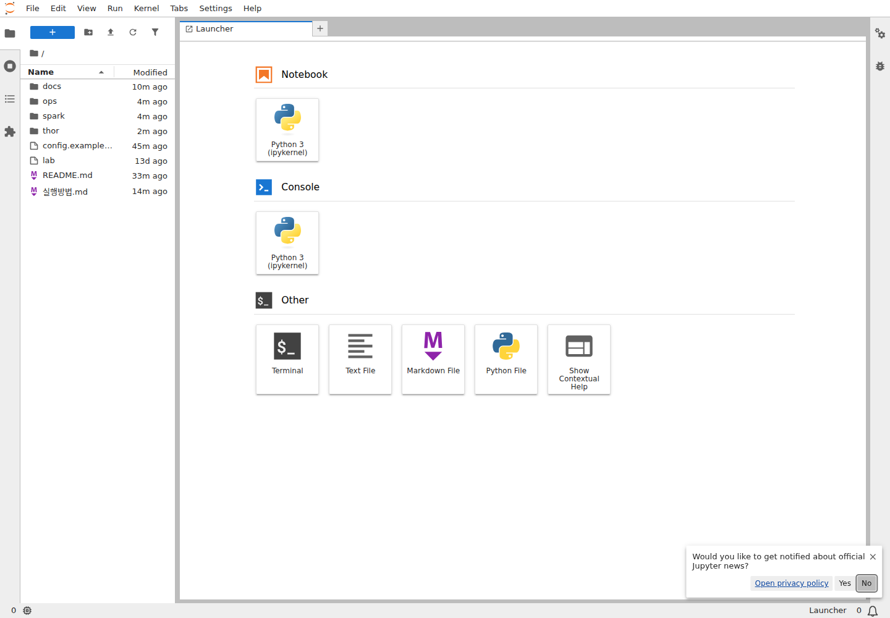

이제부터의 명령은 **이 VM 터미널 안에서** 실행한다. 코드·모델을 받기 전에 확인한다.

```bash
uname -m
nvidia-smi
df -h
lsblk
```

`x86_64`, 선택한 RTX GPU, 충분한 디스크가 보여야 한다. CUDA 13을 지원하는 드라이버가 없는 VM이면 먼저 제공자의 드라이버·CUDA 13 환경을 준비한다. CPU VM에서 계속 진행하지 않는다.

저장공간은 VM 사양의 숫자와 실제 작업 폴더의 여유 공간을 함께 확인한다. 루트 디스크가 작고 별도 대용량 볼륨이 있다면 그 볼륨에 작업 폴더를 만든다. **아직 저장소를 받기 전**, 아래 명령에 `df -h`에서 확인한 볼륨의 마운트 경로를 입력한다.

```bash
read -rp '대용량 볼륨의 마운트 경로: ' DATA_MOUNT
mountpoint -q "$DATA_MOUNT" || { echo '실제 볼륨 마운트 경로를 입력하세요.'; exit 1; }
DATA_PROJECT="$DATA_MOUNT/cosmos-lab"
sudo mkdir -p "$DATA_PROJECT"
sudo chown "$(id -u):$(id -g)" "$DATA_PROJECT"
test ! -e "$HOME/physical-ai-system-design" && \
  ln -s "$DATA_PROJECT" "$HOME/physical-ai-system-design"
df -h "$HOME/physical-ai-system-design"
```

AWS DLAMI의 임시 NVMe는 `/opt/dlami/nvme`로 보일 수 있다. **임시 볼륨은 VM 중지·삭제 시 데이터를 잃을 수 있으므로 [결과 백업](#results) 후 종료한다.** 이미 저장소가 있는 경로에는 위 명령을 다시 실행하지 않는다. 루트 디스크만으로 충분하면 이 단계를 건너뛴다.

이어서 [공통 준비](#common)를 수행한다. 빈 작업 폴더에 만든 바로가기도 `git clone`의 목적지로 사용할 수 있다. `uv`와 Hugging Face 캐시는 `Cosmos/.cache/`에 저장한다.

### 4-3. 드라이버와 두 실행 환경 설치

아래 드라이버 준비 명령은 **새 AWS `g6e.2xlarge`·Ubuntu 22.04·L40S 1개 VM**에 해당한다. 이 VM의 기본 595 계열 드라이버는 Isaac Sim 5.1의 RTX 초기화와 충돌할 수 있다. [NVIDIA 호환성 안내](https://github.com/isaac-sim/IsaacSim/discussions/648)

시뮬레이터나 추론을 실행하기 전에 수행한다. Spark·Thor에서는 실행하지 않는다.

```bash
./ops/setup-brev-driver.sh
nvidia-smi
```

`Driver Version: 580.65.06`을 확인한다. 다른 제공자의 VM은 해당 이미지의 드라이버 설치 방식을 사용해야 하며, 이 스크립트의 대상에 포함되지 않는다. 드라이버를 준비한 후 Python 환경을 설치한다.

```bash
./spark/scripts/setup.sh
./ops/setup-inference.sh
./spark/scripts/spark-python -m pytest tests -q
```

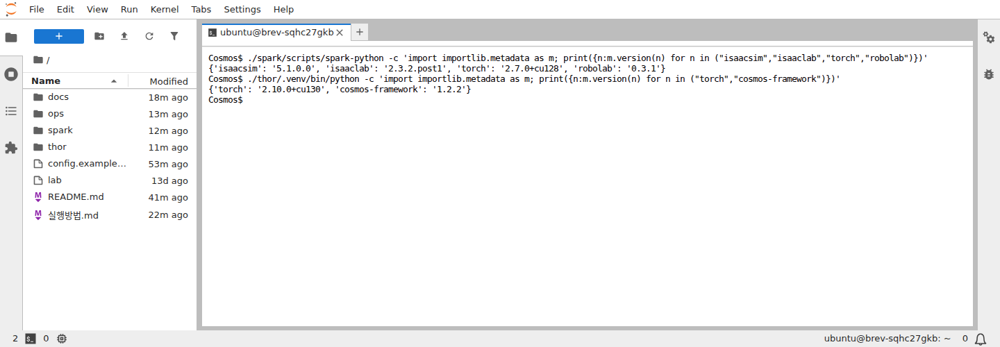

시뮬레이터는 `spark/.venv`, 추론은 `thor/.venv`를 사용한다. `setup.sh`는 CPU 아키텍처에 따라 Spark와 x86의 PyTorch wheel을 구분한다. 설치가 끝나면 같은 VM에서 [모델 받기](#models)를 수행한다.

### 4-4. 정책 서버 시작

**VM 터미널 A**에서 실행하고 열어둔다.

```bash
cd "$HOME/physical-ai-system-design/Cosmos"
source ops/tutorial-env.sh cloud
POLICY_RUN="policy_$(date +%Y%m%d_%H%M%S)"
LD_LIBRARY_PATH= ./thor/.venv/bin/python thor/serve.py \
  --workspace "$PROJECT_ROOT/thor" --run "$POLICY_RUN" \
  --host 127.0.0.1 --port 8000 --seed 0
```

**VM 터미널 B**를 새로 열고 실행한다.

```bash
cd "$HOME/physical-ai-system-design/Cosmos"
source ops/tutorial-env.sh cloud
./spark/scripts/spark-python -m cosmos_spark.network \
  --uri ws://127.0.0.1:8000 --handshake
```

이 구성에서는 SSH 자기 접속이나 8000번 포트의 외부 공개가 필요 없다. 준비되면 [행동 실험](#policy)을 실행한다.

### 4-5. 브라우저에서 GUI 보기와 녹화

**VM 터미널 B**에서 가상 데스크톱을 시작한다. 별도의 GPU를 추가하지 않는다.

```bash
./ops/start-cloud-desktop.sh
source ops/tutorial-env.sh cloud-gui
```

**자신의 PC의 Ubuntu 터미널**에서 Brev CLI를 설치하고 로그인한다. 웹 로그인과 CLI 로그인은 별도다. 이미 CLI 로그인을 완료했다면 설치·로그인을 생략한다.

```bash
curl -fsSL https://raw.githubusercontent.com/brevdev/brev-cli/main/bin/install-latest.sh | bash
export PATH="$HOME/.local/bin:$PATH"
brev login
brev refresh
brev ls
read -rp '생성한 Brev 인스턴스 이름: ' BREV_INSTANCE
ssh -T -N -o ExitOnForwardFailure=yes \
  -L 127.0.0.1:16080:127.0.0.1:6080 "$BREV_INSTANCE"
```

설치 후 `brev`를 찾지 못하면 새 터미널을 연다. [Brev CLI 설치 안내](https://docs.nvidia.com/brev/latest/cli/getting-started)

터널을 유지한 채 PC 브라우저에서 [클라우드 데스크톱](http://127.0.0.1:16080/vnc.html?autoconnect=1&resize=scale)을 연다. 처음에는 빈 화면이며, [행동 실험](#policy)을 시작하면 Isaac Sim 창이 나타난다. 접속은 SSH 터널을 사용하므로 5900·6080번 포트를 외부에 공개하지 않는다.

`cloud-gui` 설정은 Isaac Sim 창을 띄우고 해당 창을 자동으로 녹화한다. 녹화는 `spark/captures/<실행 ID>/gui_wallclock.mp4`, 카메라 영상과 실험 결과는 `spark/runs/<실행 ID>/`에 따로 저장된다. 창 녹화에는 로딩 시간과 실제 추론 대기 시간이 포함된다. 첫 렌더링은 셰이더 캐시 준비로 수 분 걸릴 수 있다.

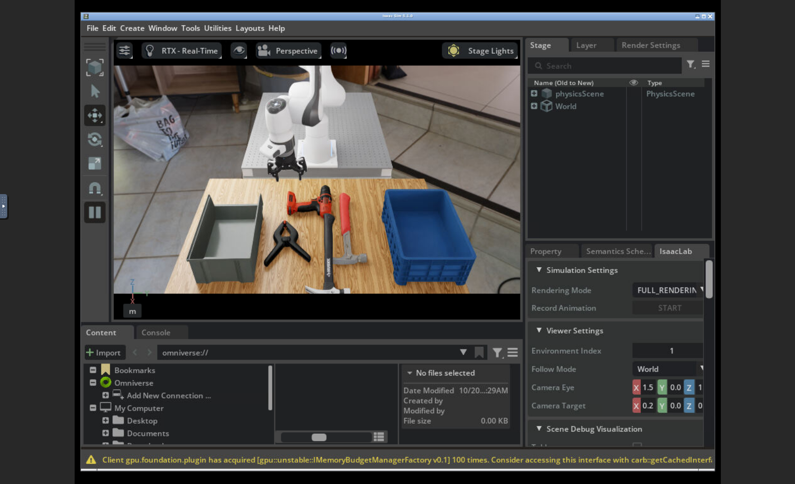

Simulation Settings 팝업이 장면을 가리면 팝업의 닫기 버튼을 누른다. 녹화 중에는 다른 창으로 Isaac Sim 창을 가리지 않는다. `recording_valid`는 영상 파일의 기술적 유효성을 뜻하므로, 녹화 후 실제 장면도 재생해 확인한다.

화면 없이 실행하려면 `source ops/tutorial-env.sh cloud`로 전환한다. 새 터미널에서는 사용할 모드를 다시 선택한다.

<a id="models"></a>
## 5. Hugging Face: 모델 받기

**로컬은 Thor, Brev는 VM**에서 실행한다.

1. [정책 모델 페이지](https://huggingface.co/nvidia/Cosmos3-Edge-Policy-DROID)와 [Edge 모델 페이지](https://huggingface.co/nvidia/Cosmos3-Edge)를 연다.
2. 약관 동의나 접근 요청 화면이 있으면 자신의 계정으로 완료한다.
3. **Settings → Access Tokens → Create new token**에서 모델 읽기 권한을 가진 토큰을 만든다.

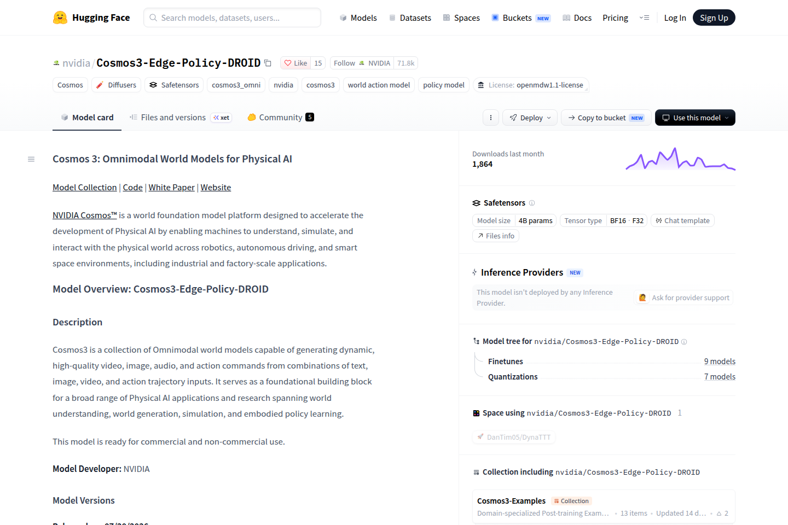

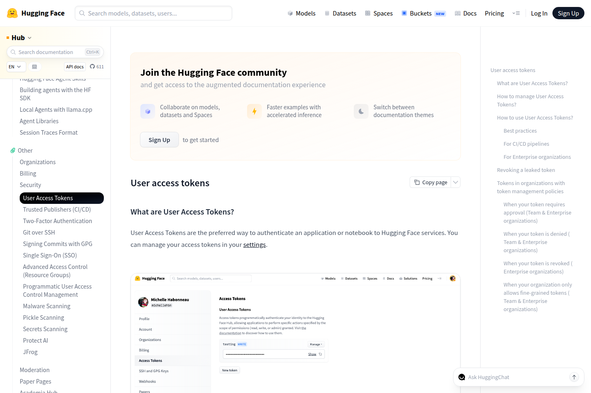

이미지 안 토큰 화면은 Hugging Face 문서의 예시다. 다운로드에는 `Read` 권한을 사용하며 토큰 값은 문서나 저장소에 기록하지 않는다. [토큰 안내](https://huggingface.co/docs/hub/security-tokens)

```bash
cd "$HOME/physical-ai-system-design/Cosmos"
export PROJECT_ROOT="$PWD"
export UV_CACHE_DIR="$PROJECT_ROOT/.cache/uv"
export HF_HOME="$PROJECT_ROOT/.cache/huggingface"
export PATH="$HOME/.local/bin:$PATH"
uvx hf auth login
./thor/.venv/bin/python thor/prepare.py --workspace "$PROJECT_ROOT/thor" --part model
./thor/.venv/bin/python thor/prepare.py --workspace "$PROJECT_ROOT/thor" --part edge
```

프롬프트가 나오면 토큰을 입력한다. 행동·예측만 해볼 때는 `--part model`까지만 필요하다. 다운로드는 고정 리비전을 사용하며 완료 후 각 모델 폴더에 `download.json`이 생긴다. 가중치는 수 GB 이상이므로 완료될 때까지 기다린다. 첫 정책·영상 생성 실행에서는 Framework가 Wan2.2 VAE 등 보조 가중치도 고정 리비전으로 자동 다운로드한다. 첫 모델 로딩이 끝날 때까지 인터넷 연결을 유지한다.

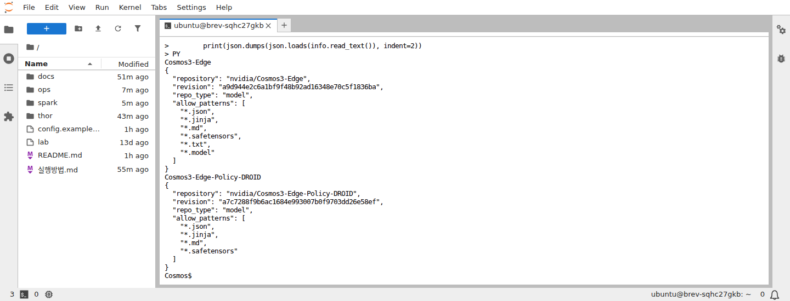

이미 설치된 별도 Thor 작업 공간을 사용하는 경우에는 위의 Python 경로와 `--workspace`를 그 공간에 맞춘다. 모델 이름과 리비전은 바꾸지 않는다.

<a id="policy"></a>
## 6. 행동 실험: 바나나·큐브·망치

먼저 정책 서버와 연결 확인을 완료한다. **로컬은 Spark의 데스크톱 터미널**, **Brev는 VM 터미널 B**에서 실행한다. 아래 두 명령 중 자신의 구성 하나만 선택한다.

로컬 Spark:

```bash
source ops/tutorial-env.sh local
```

Brev VM:

```bash
source ops/tutorial-env.sh cloud
```

브라우저 GUI와 자동 녹화를 사용하려면 [4-5](#brev)를 먼저 완료하고, 위 `cloud` 대신 `source ops/tutorial-env.sh cloud-gui`를 실행한다.

### 6-1. 바나나 한 번 옮기기

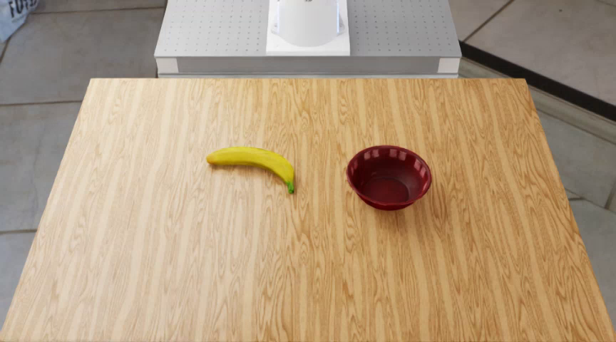

```bash
RUN_ID="banana_$(date +%Y%m%d_%H%M%S)"
./spark/scripts/spark-python -m "$SIM_MODULE" \
  --mode policy --run-id "$RUN_ID" --task BananaInBowlTask \
  --scenario-id BananaInBowlTask --experiment-track banana_link \
  --episodes 1 --seed 0 --policy-seed 1000 --execute-horizon 16 \
  --timeout 120 "${SIM_ARGS[@]}"
```

종료 후 추가 관찰을 별도 실행한다. 종료 영상 분석에도 사용할 자료다.

```bash
RUN_ID="banana_settle_$(date +%Y%m%d_%H%M%S)"
./spark/scripts/spark-python -m "$SIM_MODULE" \
  --mode policy --run-id "$RUN_ID" --task BananaInBowlTask \
  --scenario-id BananaInBowlTask --experiment-track banana_link \
  --episodes 1 --seed 0 --policy-seed 1200 --execute-horizon 16 \
  --timeout 120 --post-terminal-seconds 3 "${SIM_ARGS[@]}"
```

이 실행은 첫 바나나 실행 및 정식 30회와 별도로 기록한다. 추가 관찰은 종료 시점의 팔 관절과 마지막 그리퍼 명령을 유지한 채 물리만 3초 진행한다. `episode.json`의 `post_terminal_observation.strict_secondary_check`를 확인한다. 종료 판정이 `success`여도 이후 물체가 떨어지면 이 추가 기준은 `false`다. 원래 성공 판정을 수정하거나 두 기준을 하나의 성공률로 합치지 않는다.

완료 후 결과를 확인한다.

```bash
python3 - "$PROJECT_ROOT/spark/runs/$RUN_ID/episode_0000/episode.json" <<'PY'
import json, sys
r=json.load(open(sys.argv[1]))
print({k:r.get(k) for k in ('status','steps','termination_reason','simulated_elapsed_s','wall_elapsed_s')})
PY
```

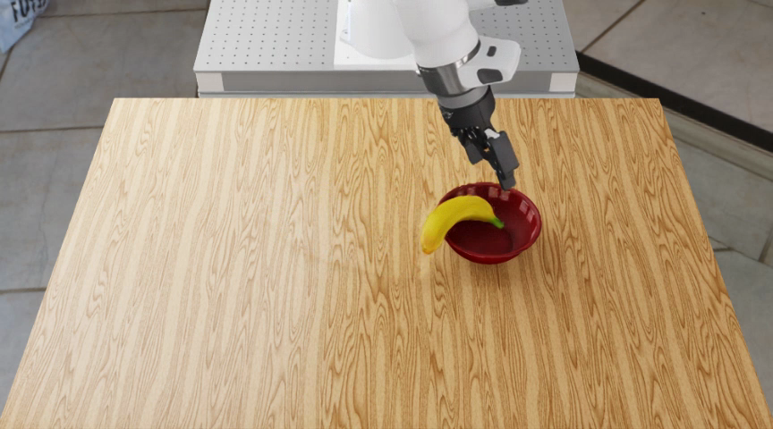

`success`는 시뮬레이터 성공, `task_failure`는 자연 시간 제한 내 목표 미달이다. `execution_error`는 환경·통신·실행 오류이므로 작업 실패 통계에 넣지 않는다. 카메라 영상의 시간은 시뮬레이션 시간이며, 실제 기다린 시간과 다르다.

### 6-2. 큐브 또는 망치

아래에서 `TASK` 한 줄만 선택하고 실행한다.

```bash
TASK=RubiksCubeTask
# 망치 두 개 정리는 대신 다음 값을 사용:
# TASK=ToolOrganizationTask

RUN_ID="${TASK}_$(date +%Y%m%d_%H%M%S)"
./spark/scripts/spark-python -m "$SIM_MODULE" \
  --mode policy --run-id "$RUN_ID" --task "$TASK" \
  --scenario-id "$TASK" --experiment-track new_standalone \
  --episodes 1 --seed 0 --policy-seed 1200 --execute-horizon 16 \
  --timeout 120 --post-terminal-seconds 3 "${SIM_ARGS[@]}"
```

망치 작업은 두 망치를 목표 통에 넣는 작업이다. 접근·들어 올리기만으로 성공 처리하지 않는다. `--max-steps`를 넣으면 도중에 잘릴 수 있으므로 종료 결과 실험에서는 사용하지 않는다. 설정 비교는 다음 6-4에서 별도로 수행한다.

### 6-3. 망치 작업의 난도를 낮춰 비교하기

일반 정책 서버를 실행한 상태에서 아래 두 조건을 순서대로 수행한다. 두 조건 모두 목표는 **빨간 망치를 목표 통에 넣기**이며 제한 시간은 시뮬레이션 기준 60초다. 두 번째 조건은 드릴도 제거한다.

```bash
for VARIANT in single-red-hammer-60s single-red-hammer-no-drill-60s; do
  RUN_ID="${VARIANT}_$(date +%Y%m%d_%H%M%S)"
  ./spark/scripts/spark-python -m "$SIM_MODULE" \
    --mode policy --run-id "$RUN_ID" --task ToolOrganizationTask \
    --scenario-id "$VARIANT" --experiment-track new_standalone \
    --goal-variant "$VARIANT" --episodes 1 --seed 0 --policy-seed 1200 \
    --execute-horizon 16 --timeout 120 --post-terminal-seconds 3 "${SIM_ARGS[@]}" || break
done
```

공식 두 망치 작업과는 목표·물체 구성이 다르므로 결과를 합산하지 않는다. 각 `episode.json`과 마지막 카메라 영상을 확인한다.

### 6-4. 공식 실행 경로의 설정 비교

일반 정책 서버를 종료한다. 이 실험은 고정한 공식 Framework의 서버와 RoboLab 실행 경로를 사용한다. 일반 정책 실험의 요청별 시드 규칙과 다르므로 전용 서버를 사용한다.

**추론 장비 터미널**에서 비교용 환경을 설치한다. 로컬은 Thor, Brev는 같은 VM이다.

```bash
./ops/setup-reference.sh
export INFERENCE_ROOT="$PROJECT_ROOT/thor"
export REFERENCE_ROOT="$INFERENCE_ROOT/external/cosmos-framework-reference-20261005"
```

아래 표의 각 행을 한 번씩 수행한다. **행마다 서버를 종료하고 새 프로세스로 시작**해 난수 생성기를 초기화한다. 환경 시드는 0, 서버 난수 시드는 1200이다.

| CASE | TASK | HORIZON | INTERVAL |
|---|---|---|---|
| banana_reference | BananaInBowlTask | 32 | on |
| hammer_reference | ToolOrganizationTask | 32 | on |
| hammer_no_interval | ToolOrganizationTask | 32 | off |
| hammer_horizon16 | ToolOrganizationTask | 16 | on |

**추론 장비 터미널 A:** 표에서 선택한 `CASE`와 `INTERVAL`을 입력한다.

```bash
CASE=banana_reference
INTERVAL=on
REFERENCE_RUN="reference_${CASE}_$(date +%Y%m%d_%H%M%S)"
LD_LIBRARY_PATH= COSMOS_THOR_CODE="$PROJECT_ROOT/thor" \
  "$REFERENCE_ROOT/.venv/bin/python" spark/scripts/thor/official_reference_server.py \
  --workspace "$INFERENCE_ROOT" --framework "$REFERENCE_ROOT" \
  --run "$REFERENCE_RUN" --interval "$INTERVAL" --host 127.0.0.1 --port 8000
```

**Spark 또는 VM 터미널 B:** 로컬은 기존 SSH 터널을 유지한다. 서버 로딩 후 같은 행의 값을 선택한다.

```bash
CASE=banana_reference
TASK=BananaInBowlTask
HORIZON=32
RUN_ID="official_${CASE}_$(date +%Y%m%d_%H%M%S)"
if [[ "$SIM_MODULE" == cosmos_spark.session ]]; then
  ./spark/scripts/spark-python -m cosmos_spark.session --entrypoint official \
    --run-id "$RUN_ID" --task "$TASK" --horizon "$HORIZON"
else
  ./spark/scripts/spark-python scripts/official_reference_client.py \
    --run-id "$RUN_ID" --task "$TASK" --horizon "$HORIZON" --headless
fi
```

공식 작업의 시간 제한과 성공 조건은 유지한다. 망치의 `left_bin`은 화면의 왼쪽이라는 뜻이 아니며, 기본 관찰 화면에서는 오른쪽의 파란 통이다. 망치 하나를 잠시 넣었다가 떨어뜨리는 경우도 마지막 영상으로 확인한다.

네 행을 마치면 터미널 A의 공식 비교 서버를 `Ctrl+C`로 종료한다.

공식 평가 결과는 `spark/RoboLab/output/<실행 ID>/`, 카메라 영상과 추가 기록은 `spark/runs/<실행 ID>/`에 저장된다. 이 비교는 네 개의 사례 실험이며 전체 공식 벤치마크의 성공률을 측정하지 않는다. 관찰·행동·카메라·상태 기록을 추가하므로 실행 시간에는 기록 비용도 포함된다.

<a id="prediction"></a>
## 7. 예측 영상과 실제 움직임 비교

예측은 정책 서버가 영상도 디코딩하도록 다시 시작해야 한다. 실행 중인 로봇 실험이 끝난 다음 전환한다.

**로컬 — Spark:** 공식 비교 서버를 수동으로 실행했다면 Thor의 해당 터미널에서 먼저 `Ctrl+C`로 종료한다.

```bash
./lab stop
./lab start --decode-video --seed 0
```

**Brev — 터미널 A:** 기존 서버를 `Ctrl+C`로 종료하고 다시 실행한다.

```bash
POLICY_RUN="prediction_$(date +%Y%m%d_%H%M%S)"
LD_LIBRARY_PATH= ./thor/.venv/bin/python thor/serve.py \
  --workspace "$PROJECT_ROOT/thor" --run "$POLICY_RUN" \
  --host 127.0.0.1 --port 8000 --seed 0 --decode-video
```

**Spark 또는 VM 터미널 B:** 연결 확인 후 실행한다.

```bash
./spark/scripts/spark-python -m cosmos_spark.network --handshake
RUN_ID="forecast_$(date +%Y%m%d_%H%M%S)"
./spark/scripts/spark-python -m "$SIM_MODULE" \
  --mode predict --run-id "$RUN_ID" --task RubiksCubeTask \
  --scenario-id RubiksCubeTask --experiment-track new_standalone \
  --episodes 1 --seed 0 --policy-seed 1200 --execute-horizon 32 \
  --timeout 180 "${SIM_ARGS[@]}"
```

`spark/runs/<실행 ID>/episode_0000/`의 `prospective_comparison.mp4`와 `.json`을 확인한다. 같은 32개 행동에 대해 예측과 실제 화면을 비교한다. 바나나 연결 실험은 같은 명령에서 `--task`와 `--scenario-id`를 `BananaInBowlTask`, `--experiment-track`을 `banana_link`, `--policy-seed`를 `314159`로 바꾸고 새로운 `RUN_ID`로 실행한다. 한 작업 전체의 성공 평가가 아니며, 결과가 `diagnostic_complete`인 것은 정상이다. 영상은 해시 검사 후 행동을 실행한다.

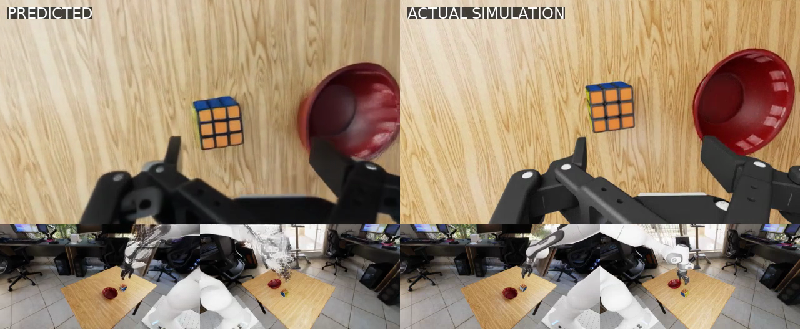

왼쪽은 예측, 오른쪽은 실제 시뮬레이션이다. 각 절반의 위는 손목 카메라, 아래 두 장은 같은 로봇의 외부 카메라다. 예측의 로봇 형태가 흐트러지는 부분처럼 실제와 다른 움직임·형태를 확인한다. 영상 출력 완료를 물리적 정확성으로 해석하지 않는다.

<a id="media"></a>
## 8. 종료 영상 분석과 조명 변화 영상 생성

### 8-1. 입력 자료 만들기

**Spark 또는 VM 터미널 B**에서 자연 종료된 행동 실행 ID를 입력한다. 예측 전용 실행 ID는 사용하지 않는다.

전체 분석 실습은 아래 네 실행을 대상으로 한다. 각 행마다 **8-1 → 8-2 → 8-3**을 반복하면 총 14개 입력을 분석한다. 8-4의 조명 생성은 바나나 자료에서 한 번만 수행한다. 실행 ID는 각 실험에서 출력된 값을 사용한다.

| 입력을 가져올 실행 | 종료 직전 영상·정지화면 | 추가 관찰 영상·정지화면 | 입력 수 |
|---|---|---|---:|
| 6-1 바나나 추가 관찰 | 사용 | 사용 | 4 |
| 6-2 큐브 | 사용 | 사용 | 4 |
| 6-3 빨간 망치만, 드릴 유지 | 사용 | 사용 | 4 |
| 6-4 공식 망치 기준 (`hammer_reference`) | 사용 | 없음 | 2 |

```bash
read -rp '종료된 행동 실험의 실행 ID: ' COMPLETED_RUN
PACKAGE="media_$(date +%Y%m%d_%H%M%S)"
./spark/scripts/spark-python scripts/prepare_tutorial_media.py \
  --episode "$PROJECT_ROOT/spark/runs/$COMPLETED_RUN/episode_0000" \
  --output "$PROJECT_ROOT/spark/reports/$PACKAGE"
```

종료 직전 3초 영상과 마지막 정지화면, 시작 이미지, 분석·생성 입력 JSON을 만든다. `--post-terminal-seconds 3`으로 촬영한 추가 관찰 영상이 있으면 해당 영상과 마지막 정지화면도 분석 케이스에 포함된다. 정답 기록은 `reference.json`에 별도로 저장되며 모델 입력에 포함되지 않는다. 영상 분석 질문은 **종료 시점에 전체 목표를 달성했는지**이며 진행 상태 질문이 아니다. 목표 물체를 놓았는지와 그리퍼에서 분리됐는지를 묻고, 망치의 목표 통은 이 카메라에서 오른쪽 파란 통이라고 명시한다.

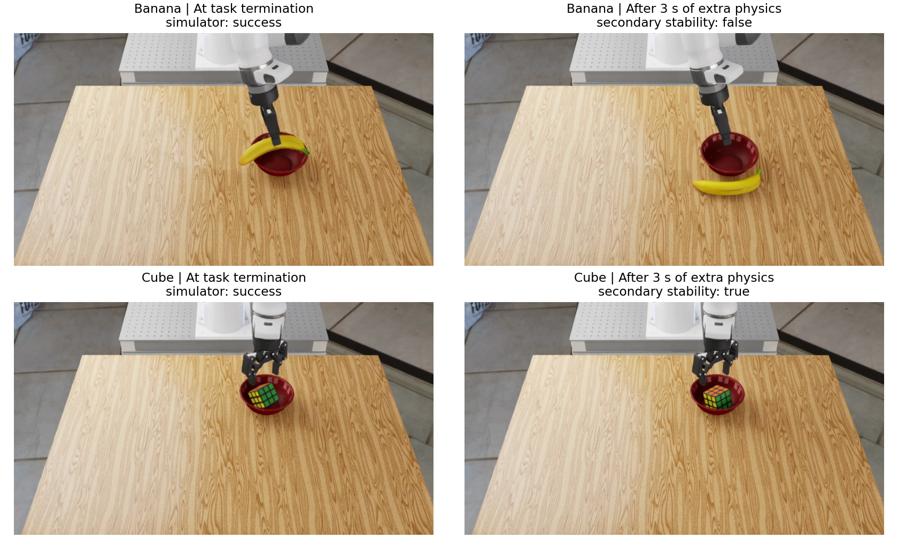

바나나가 그릇 밖으로 떨어진 예와 큐브가 남은 예다. 추가 안정성 기준은 마지막 1초 동안 원래 목표 조건 유지·대상 속도 0.02m/s 미만·두 손가락 센서의 비접촉이다. 물체 전체의 기하학적 포함이나 장시간 안정성을 보증하는 지표는 아니다.

### 8-2. 추론 장비로 자료 옮기기

**로컬 — Spark:**

```bash
./lab stop
read -rp 'Thor 접속 주소 (계정@IP): ' THOR_TARGET
THOR_ROOT=$(python3 -c 'import tomllib; print(tomllib.load(open("config.local.toml","rb"))["thor"]["workspace"])')
ssh "$THOR_TARGET" "mkdir -p '$THOR_ROOT/data'"
scp -r "$PROJECT_ROOT/spark/reports/$PACKAGE" "$THOR_TARGET:$THOR_ROOT/data/"
printf 'Thor에서 사용할 PACKAGE=%s\n' "$PACKAGE"
```

경로에는 공백·따옴표를 사용하지 않는다. 이후 **Thor 터미널**에서 추론 작업 공간으로 이동하고, 위에 출력된 PACKAGE 값을 입력한다.

```bash
cd "$HOME/physical-ai-system-design/Cosmos"
export PROJECT_ROOT="$PWD"
export UV_CACHE_DIR="$PROJECT_ROOT/.cache/uv"
export HF_HOME="$PROJECT_ROOT/.cache/huggingface"
export INFERENCE_ROOT="$PROJECT_ROOT/thor"
read -rp '복사한 PACKAGE 이름: ' PACKAGE
```

기존 Thor 작업 공간을 재사용했다면 `INFERENCE_ROOT`만 실제 경로로 바꾼다.

**Brev:** 터미널 A의 정책 서버를 `Ctrl+C`로 종료한 다음 **터미널 B**에서 실행한다.

```bash
export INFERENCE_ROOT="$PROJECT_ROOT/thor"
mkdir -p "$INFERENCE_ROOT/data"
cp -a "$PROJECT_ROOT/spark/reports/$PACKAGE" "$INFERENCE_ROOT/data/$PACKAGE"
```

### 8-3. 종료 결과 분석

**Thor 또는 Brev 추론 터미널**에서 실행한다.

```bash
ANALYSIS_RUN="analysis_$(date +%Y%m%d_%H%M%S)"
LD_LIBRARY_PATH= COSMOS_THOR_CODE="$PROJECT_ROOT/thor" \
  "$INFERENCE_ROOT/.venv/bin/python" spark/scripts/thor/media_terminal_outcome.py analyze \
  --workspace "$INFERENCE_ROOT" --manifest "$INFERENCE_ROOT/data/$PACKAGE/analysis.json" \
  --run "$ANALYSIS_RUN" --prompt-version terminal-outcome-raw-v2
```

`$INFERENCE_ROOT/outputs/thor_project/$ANALYSIS_RUN/summary.json`과 케이스별 응답을 확인한다. 분석 결과의 `status`는 추론 처리 성공 여부이며, `prediction.status`가 작업 결과 판단이다. 모델의 결론과 근거를 원본 영상·`episode.json`과 따로 대조한다. 종료 직전 입력은 원래 종료 판정과, 추가 관찰 입력은 추가 관찰의 마지막 상태와 비교한다. 원래 성공한 물체가 추가 관찰 중 떨어질 수도 있다. 형식 오류나 판단 불가도 결과로 남긴다. `error_kind: format_error`이면 `answer.txt`의 원문과 `result.json`을 함께 확인한다. JSON 밖의 문장·닫히지 않은 응답·목록 형태 등은 형식 실패로 보관하며 임의로 정답 처리하지 않는다. 이때 명령이 종료 코드 1을 반환할 수 있다.

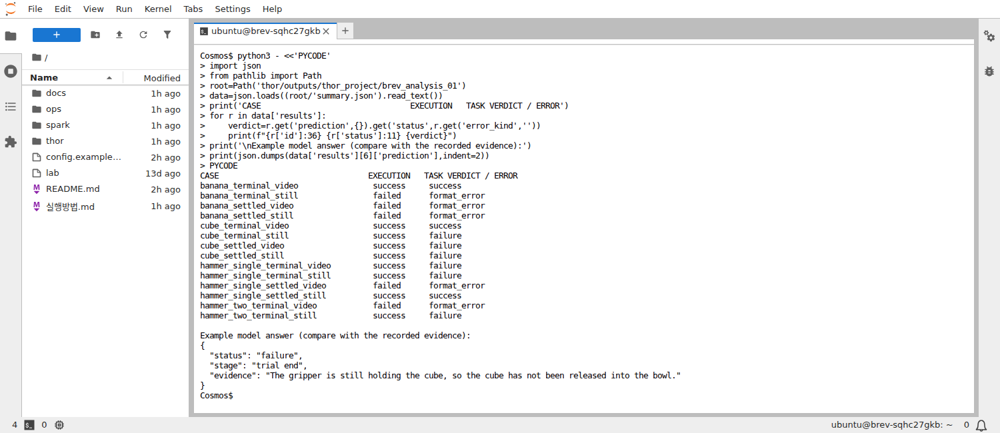

화면의 큐브 추가 관찰 사례는 센서 기준 분리가 확인됐지만 모델은 계속 잡고 있다고 판단했다. 형식이 맞는 응답도 영상·센서 기록과 대조한다.

### 8-4. 조명만 바꾸는 영상 생성

분석 프로세스가 끝난 뒤 실행한다.

```bash
GENERATION_RUN="generation_$(date +%Y%m%d_%H%M%S)"
LD_LIBRARY_PATH= "$INFERENCE_ROOT/.venv/bin/python" thor/media.py generate \
  --workspace "$INFERENCE_ROOT" --manifest "$INFERENCE_ROOT/data/$PACKAGE/generation.json" \
  --run "$GENERATION_RUN"
```

같은 출력 루트의 실행 폴더에서 `summary.json`과 생성 영상을 확인한다. 의도는 카메라·물체·로봇을 유지한 채 조명만 약간 어둡게 바꾸는 것이다. 새 물체가 생기거나 위치·형태가 바뀌면 의도 실패로 기록한다. 생성에 성공했다는 사실만으로 물리적으로 올바른 영상이라고 판단하지 않는다.

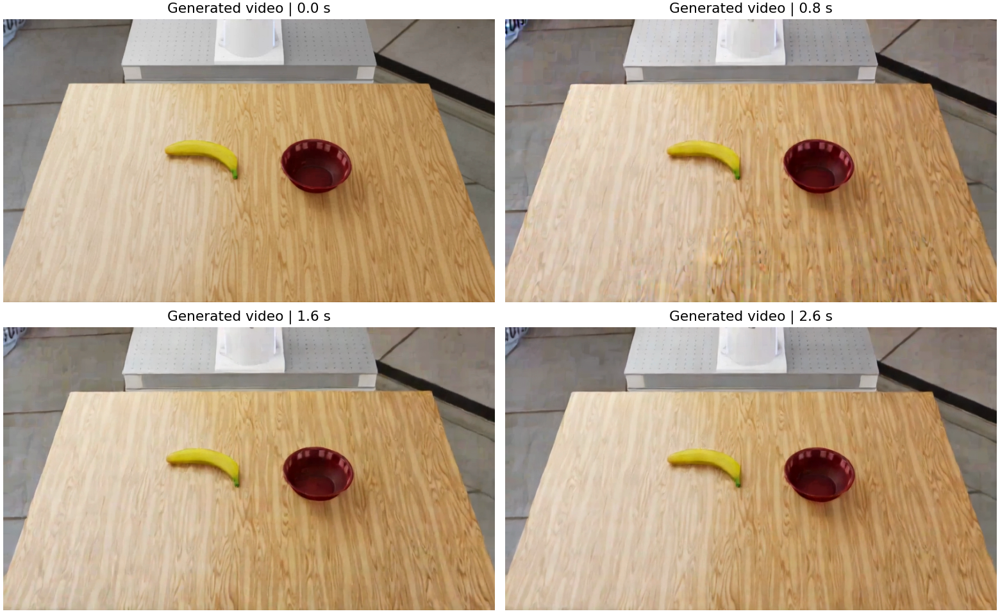

위 예시처럼 구도나 표면 무늬까지 변하면 조명만 바꾼 결과로 채택하지 않는다.

<a id="results"></a>
## 9. 반복 평가·결과 확인·종료

### 9-1. 바나나 30회 반복 평가

먼저 로컬 구성은 [정책 서버](#local)를 다시 시작한다. Brev는 [4-4](#brev) 방식으로 시작한다. **Spark 또는 VM 실험 터미널**에서 실행한다. 이 예시는 양쪽 모두 화면 녹화 없이 카메라 영상을 저장한다.

```bash
python3 - <<'PY'
import json
from pathlib import Path
src=Path('spark/configs/evaluation.example.json')
cfg=json.loads(src.read_text())
cfg.update(headless=True, record_thor=False, timeout=120)
out=Path('spark/reports/tutorial'); out.mkdir(parents=True, exist_ok=True)
(out/'evaluation.json').write_text(json.dumps(cfg, indent=2))
PY
./spark/scripts/spark-python -m cosmos_spark.evaluate \
  --config reports/tutorial/evaluation.json --plan-only
```

출력된 배치 폴더의 마지막 이름을 입력한다.

```bash
read -rp '출력된 배치 ID (eval_로 시작): ' BATCH_ID
./spark/scripts/spark-python -m cosmos_spark.evaluate --resume "runs/$BATCH_ID"
```

기본·±5cm·±10cm에서 각각 10회 수행한다. 위치 변화는 바나나와 그릇의 초기 X·Y 좌표에 적용하며 Z 높이는 유지한다. 먼저 한 항목만 시험하려면 `--max-items 1`을 붙인다. 항목 사이에서 멈춘 경우 같은 명령으로 남은 항목을 재개한다.

실행 도중 중단되거나 오류가 난 항목은 로그를 확인하고 원인을 해결한 뒤 아래처럼 재시도한다. 기존 오류 기록은 보존된다. 자연 종료된 작업 실패는 다시 실행해 성공으로 대체하지 않는다.

```bash
./spark/scripts/spark-python -m cosmos_spark.evaluate \
  --resume "runs/$BATCH_ID" --retry-errors
```

계획 생성 후 코드나 패키지를 바꿨다면 새 계획을 만든다. 완료 후 배치의 `summary.json`에서 `primary.evaluated`가 30, `not_started`가 0인지 확인한다. `primary.successes`와 `primary.task_failures`는 작업 결과이며, `primary.execution_errors`는 별도로 확인한다. 조건별 결과는 `conditions`에 있다.

### 9-2. 어디서 무엇을 볼까?

| 파일 | 확인할 내용 |
|---|---|
| `spark/runs/<ID>/episode_0000/episode.json` | 작업 결과, 종료 이유, 시간 |
| 같은 폴더의 `*.mp4` | 카메라별 실제 시뮬레이션 영상 |
| 같은 폴더의 `prospective_comparison.*` | 예측과 실제의 대응 |
| `spark/captures/<ID>/gui_wallclock.mp4` | GUI의 실제 경과 시간 녹화 |
| `spark/runs/<배치 ID>/summary.json` | 반복 평가 집계 |
| `thor/outputs/thor_project/<ID>/` | 추론 요청·응답·생성 결과 |

Brev에서는 Jupyter 파일 브라우저로 저장소 폴더를 열어 영상을 다운로드한다. 전체 결과를 옮기려면 VM에서 묶는다.

```bash
cd "$PROJECT_ROOT"
mkdir -p spark/captures spark/RoboLab/output
tar -czf cosmos-results.tar.gz \
  spark/runs spark/reports spark/captures spark/RoboLab/output thor/outputs
sha256sum cosmos-results.tar.gz > cosmos-results.tar.gz.sha256
```

자신의 PC에서 두 파일을 다운로드한 뒤 `sha256sum -c cosmos-results.tar.gz.sha256`로 전송을 확인한다. [Brev CLI](#brev)를 설치한 PC에서는 아래처럼 받을 수 있다.

```bash
brev refresh
read -rp '백업할 Brev 인스턴스 이름: ' BREV_INSTANCE
scp "$BREV_INSTANCE:physical-ai-system-design/Cosmos/cosmos-results.tar.gz" \
    "$BREV_INSTANCE:physical-ai-system-design/Cosmos/cosmos-results.tar.gz.sha256" .
sha256sum -c cosmos-results.tar.gz.sha256
```
가상환경·모델 캐시·Hugging Face 토큰은 백업 파일에 넣지 않는다. Jupyter가 해당 폴더를 보여주지 않으면 콘솔의 **Connect** 안내로 SSH/VS Code에 접속해 파일을 가져온다. 화면 녹화와 실험 결과 JSON을 함께 보관한다.

### 9-3. 종료

- 로컬: Spark에서 `./lab stop`, 터널 터미널에서 `Ctrl+C`.
- Brev: 시뮬레이터·추론을 종료하고 백업 체크섬을 확인한 뒤 콘솔에서 실습용 VM을 **Delete**한다. 삭제가 완료됐는지 확인한다. 잠시 중단하려면 **Stop**을 사용하되, 중지 상태의 저장공간 비용은 요금 화면에서 확인한다.

<a id="troubleshooting"></a>
## 10. 문제 해결

| 증상 | 확인·조치 |
|---|---|
| `Permission denied (publickey)` | 추론 접속에 쓴 계정·IP를 확인하고 `ssh-copy-id`, `ssh -o BatchMode=yes ...` 재확인 |
| 8000번 연결 실패 | 모델 로딩 완료 여부, `./lab logs`, SSH 터널 또는 VM 터미널 A 확인 |
| `Address already in use` | 기존 서버/터널을 종료한 뒤 다시 시작. 실행 ID도 새 값 사용 |
| `DISPLAY is required` | 로컬은 X11 데스크톱 사용. Brev GUI는 데스크톱 시작 후 `source ops/tutorial-env.sh cloud-gui` 실행 |
| 첫 화면이 한동안 검게 보임 | 첫 셰이더 준비는 수 분 소요. GUI 실행은 `spark/captures/<ID>/simulator.log`, 진행은 `spark/runs/<ID>/progress.json` 확인 |
| `libGLU.so.1` 없음 | 공통 준비의 `libglu1-mesa` 설치 |
| 595 드라이버에서 RTX 초기화 중 종료 | 지정 AWS VM은 실험 종료 후 `ops/setup-brev-driver.sh`로 580.65.06 준비 |
| GPU·Vulkan 초기화 실패 | RTX 지원 GPU, 드라이버, `nvidia-smi`, `vulkaninfo --summary` 확인 |
| Hugging Face 401/403 | 모델 접근 동의와 토큰 읽기 권한을 확인하고 `uvx hf auth login` 재실행 |
| 분석 종료 코드 1, `format_error` | `summary.json`과 케이스의 `answer.txt` 확인. 모델의 응답 형식 실패를 GPU 설치 오류와 구분 |
| CUDA 메모리 부족 | 다른 추론 서버 종료. 분석·생성 때 시뮬레이터도 종료. 부족하면 더 큰 VRAM 구성 사용 |
| 모델 폴더/`download.json` 없음 | `prepare.py --part model` 또는 `--part edge`를 완료했는지 확인 |
| `Another Thor experiment owns the GPU lock` | 정책 서버가 살아 있는지 확인. 종료된 뒤 분석·생성 시작 |
| 예측 영상 없음 | 정책 서버를 `--decode-video`로 다시 시작하고 handshake 확인 |
| 이미 존재하는 실행 ID/출력 폴더 | 기존 결과를 지우지 말고 새 시각의 ID로 실행 |
| 망치 작업 실패 | `task_failure`이면 마지막 영상과 종료 이유를 확인하고 작업 실패로 기록 |

설치 기준: [Isaac Sim 5.1](https://docs.isaacsim.omniverse.nvidia.com/5.1.0/installation/index.html), [Brev 시작 안내](https://docs.nvidia.com/brev/latest/getting-started/quickstart), [고정 Cosmos Framework 설치 문서](https://github.com/NVIDIA/cosmos-framework/blob/18d90eacbda778e666e6978dc1ab6ba8635400e3/docs/setup.md).
